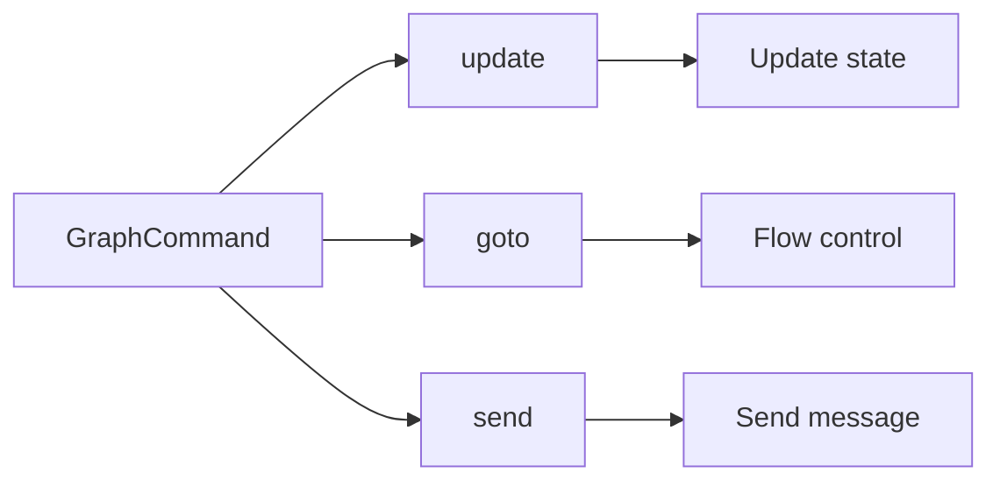
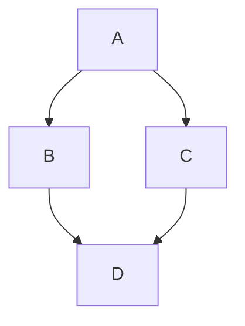
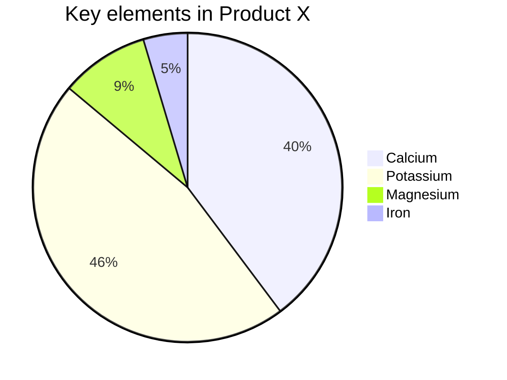
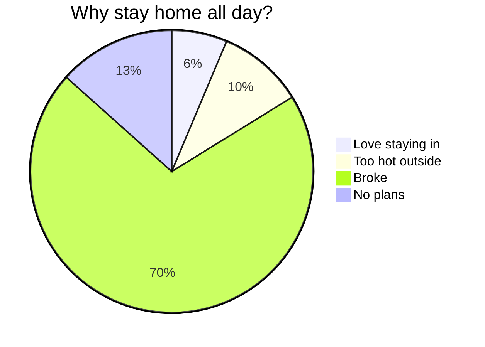
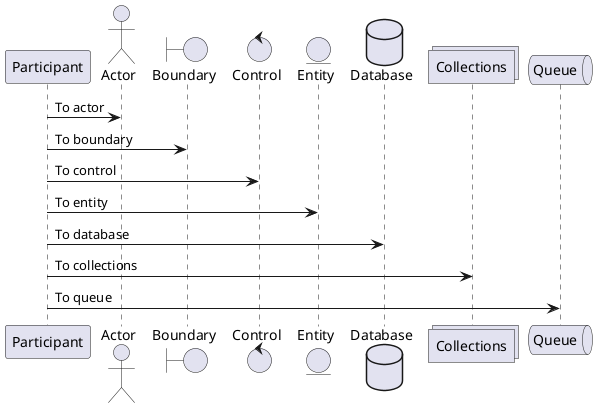

# Entdecke die wunderbare Welt von Markdown

Willkommen in der wunderbaren Welt von Markdown! Egal, ob du schreibst, entwickelst, blogst oder einfach etwas notieren willst: Markdown kann dein neuer Begleiter sein. Es macht das Schreiben einfach und klar und verwandelt einfachen Text mühelos in schöne Webseiten. Heute gehen wir die Grundlagen und die fortgeschrittene Syntax von Markdown durch, damit du beim Schreiben Freude hast.

Markdown ist eine leichtgewichtige Auszeichnungssprache, um einfachen Text zu formatieren. Bekannt für ihre schlichte, intuitive Syntax, kann sie schnell HTML erzeugen. Markdown verbindet Schreiben und Code — einfach und trotzdem leistungsstark.

## Grundlagen von Markdown

### 1. Überschriften: Gliedere deine Inhalte

Erstelle Überschriften mit `#`. Die Anzahl der `#`-Zeichen gibt die Ebene an.

```markdown
# Heading 1

## Heading 2

### Heading 3

#### Heading 4
```

Das Beispiel oben ergibt eine klare Hierarchie und hält deine Inhalte geordnet.

### 2. Absätze und Zeilenumbrüche: Ein natürlicher Fluss

In Markdown sind Absätze aufeinanderfolgende Textzeilen. Für einen neuen Absatz lässt du eine Leerzeile zwischen zwei Textblöcken.

### 3. Textstile: Hebe deine Worte hervor

- **Fett**: Umschließe den Text mit zwei Sternchen oder Unterstrichen, z. B. `**fett**` oder `__fett__`.
- _Kursiv_: Umschließe den Text mit einem Sternchen oder Unterstrich, z. B. `*kursiv*` oder `_kursiv_`.
- ~~Durchgestrichen~~: Umschließe den Text mit zwei Tilden, z. B. `~~durchgestrichen~~`.
- ==Hervorhebung==: Umschließe den Text mit zwei Gleichheitszeichen, z. B. `==hervorhebung==`.
- ++Unterstrichen++: Umschließe den Text mit zwei Pluszeichen, z. B. `++unterstrichen++`.
- ~Wellenlinie~: Umschließe den Text mit einer Tilde, z. B. `~welle~`.

Diese einfachen Zeichen geben deinem Text Struktur und Betonung.

### 4. Listen: Klar und geordnet

- **Unsortierte Liste**: Beginne eine Zeile mit `-`, `*` oder `+` und einem Leerzeichen.
- **Nummerierte Liste**: Beginne eine Zeile mit einer Zahl und einem Punkt (`1.`, `2.`).

Brauchst du verschachtelte Inhalte? Rücke ein, um Einträge zu verschachteln.

- Unsortierter Eintrag 1
  1. Verschachtelter nummerierter Eintrag 1
  2. Verschachtelter nummerierter Eintrag 2
- Unsortierter Eintrag 2

1. Nummerierter Eintrag 1
2. Nummerierter Eintrag 2

### 5. Links und Bilder: Reichere deine Inhalte an

- **Link**: Verwende eckige und runde Klammern — `[Anzeigetext](url)`.
- **Bild**: Wie ein Link, aber mit vorangestelltem `!`, z. B. ``.

[Doocs besuchen](https://github.com/doocs)


Reichhaltige Medien, ganz einfach!

> WeChat-Offizialkonten erlauben nur Links zu anderen Inhalten von Offizialkonten. Externe Links können wie Links aussehen, lassen sich aber nicht öffnen.

> Schreibe solche URLs als normalen Text oder aktiviere **Format → Link → Quellenangabe**, damit Leserinnen und Leser die Ziele unten sehen.

Du kannst auch eine horizontale Bildstrecke mit `<,>` anlegen. Das funktioniert in WeChat-Offizialkonten. Verwende ähnlich große Bilder für das beste Ergebnis.

### 6. Zitate: Zitate und nachdenkliche Zeilen

Erstelle ein Zitat mit `>`. Für verschachtelte Zitate setzt du auf der nächsten Ebene ein weiteres `>`.

> Das ist ein Zitat
>
> > Das ist ein verschachteltes Zitat

Verschachtelte Zitate geben deinen Belegen mehr Tiefe.

### 7. Codeblöcke: Zeige deinen Code

- **Inline-Code**: Mit Backticks umschließen, z. B. `Code`.
- **Codeblock**: Mit drei Backticks umschließen und eine Sprache angeben, z. B.:

```js
console.log(`Hello, Doocs!`)
```

Syntaxhervorhebung macht Code leichter lesbar.

### 8. Trennlinien: Abschnitte trennen

Erstelle eine Linie mit drei oder mehr Zeichen `-`, `*` oder `_`.

---

So setzt du visuelle Trennungen in deine Inhalte.

### 9. Tabellen: Daten klar darstellen

Markdown unterstützt einfache Tabellen mit `|` und `-`, um Zellen und Kopfzeilen zu trennen.

| Mitwirkende                                 | E-Mail                 | WeChat-ID    |
| ------------------------------------------- | ---------------------- | ------------ |
| [yanglbme](https://github.com/yanglbme)     | contact@yanglibin.info | YLB0109      |
| [YangFong](https://github.com/YangFong)     | yangfong2022@gmail.com | yq2419731931 |

Tabellen halten Daten übersichtlich und lesbar!

> Keine Lust, Tabellenmarkup von Hand zu schreiben? Nutze **Bearbeiten → Tabelle einfügen** im Menü oben links für ein schnelles Einfügen.

### 10. Inhaltsverzeichnis: Automatische Navigation

Setze `[TOC]` in eine eigene Zeile, um aus deinen Überschriften ein hierarchisches Inhaltsverzeichnis zu erzeugen.

```markdown
[TOC]
```

> Überschriften der Ebene 1 (`#`) sind ausgenommen. Ankerlinks entstehen aus der Position jeder Überschrift im Dokument.

## Fortgeschrittenes Markdown

### 1. LaTeX-Formeln: Mathematik, die sitzt

Markdown kann LaTeX-Mathematik einbetten:

- **Inline**: Mit `$` umschließen, z. B. $E = mc^2$.
- **Block**: Mit `$$` umschließen, z. B.:

$$
\begin{aligned}
d_{i, j} &\leftarrow d_{i, j} + 1 \\
d_{i, y + 1} &\leftarrow d_{i, y + 1} - 1 \\
d_{x + 1, j} &\leftarrow d_{x + 1, j} - 1 \\
d_{x + 1, y + 1} &\leftarrow d_{x + 1, y + 1} + 1
\end{aligned}
$$

Standard-LaTeX-Begrenzer werden ebenfalls unterstützt:

- **Inline**: `\(...\)`, z. B. \(x^2 + y^2 = z^2\).
- **Block**: `\[...\]`, z. B.:

\[
\int\_{-\infty}^{\infty} e^{-x^2} dx = \sqrt{\pi}
\]

Du kannst Stile in einem Absatz mischen: klassisch $a + b = c$ und LaTeX \(d + e = f\).

1. Blockformel in einer Liste 1

$$
\chi^2 = \sum \frac{(O - E)^2}{E}
$$

2. Blockformel in einer Liste 2

$$
\chi^2 = \sum \frac{(|O - E| - 0.5)^2}{E}
$$

Perfekt für komplexe Mathematik!

> [!TIP]
> Klicke in der Vorschau auf eine LaTeX-Formel, um den Formeleditor zu öffnen, inklusive eingebauter Formelbibliothek für schnelle Änderungen.

### 2. Mermaid-Diagramme: Abläufe sichtbar machen

Mit Mermaid erstellst du Flussdiagramme, Sequenzdiagramme und mehr direkt in Markdown.









Diagramme machen Abläufe klar und Dokumente professioneller.

> Mehr dazu: [Mermaid-Benutzerhandbuch](https://mermaid.js.org/intro/getting-started.html).

### 3. PlantUML-Diagramme: Abläufe sichtbar machen

PlantUML ist ein weiteres starkes Werkzeug für Flussdiagramme, Sequenzdiagramme und mehr in Markdown.



> Mehr dazu: [PlantUML-Startseite](https://plantuml.com/).

### 4. Infografik: Daten sichtbar machen

Eine Infografik-Engine der nächsten Generation, die Text zum Leben erweckt!

```infographic
infographic list-row-horizontal-icon-arrow
data
  title Customer growth engine
  desc Multi-channel reach and repurchase
  items
    - label Lead acquisition
      value 18.6
      desc Ads and content acquisition
      icon rocket-launch
    - label Conversion lift
      value 12.4
      desc Lead scoring and follow-ups
      icon progress-check
    - label Repurchase
      value 9.8
      desc Membership and benefits
      icon account-sync
    - label Word of mouth
      value 6.2
      desc Community incentives and referrals
      icon account-group
```

> Mehr dazu: [AntV-Infografik-Galerie](https://infographic.antv.vision/gallery).

### 5. Ruby-Annotationen: Lautschrift

Zwei Formate werden unterstützt:

```md
1. [text]{reading}
2. [text]^(reading)
```

So sehen sie aus:

[你好]{nǐ hǎo} [世界]{shì jiè}

Unterstützte Trennzeichen: `・` (Mittelpunkt), `．` (Punkt in voller Breite), `。` (ideografischer Punkt), `-` (Bindestrich)

Beispiele:

```md
[你好世界]{nǐ・hǎo・shì・jiè}
[小夜時雨]^(さ・よ・しぐれ)
```

[你好世界]{nǐ・hǎo・shì・jiè}
[小夜時雨]^(さ・よ・しぐれ)

Wenn die Anzahl der Silben und Trennzeichen nicht zusammenpasst, wird automatisch die nächste passende Aufteilung gewählt.

```md
[小夜時雨]{さ・よ・しぐれ}
[小夜時雨]{さ・よ}
[小夜]{さ・よ・しぐれ}
[小夜時雨]{さ・よ・しぐれ・extra}
```

[小夜時雨]{さ・よ・しぐれ}
[小夜時雨]{さ・よ}
[小夜]{さ・よ・しぐれ}
[小夜時雨]{さ・よ・しぐれ・extra}

### 6. Hinweise und Umgebungen: Wichtiges hervorheben

Mit `> [!type]` oder `::: type ... :::` erzeugst du gestaltete Hinweise. Hinter dem Typ kannst du einen **eigenen Titel** setzen; der Inhalt unterstützt volles Markdown und Mathematik.

Häufige Hinweistypen:

> [!NOTE]
> Informationen, die auch beim Überfliegen auffallen sollen.

> [!TIP]
> Hilfreiche Tipps, die eine Aufgabe leichter machen.

> [!IMPORTANT] Vor der Veröffentlichung lesen
> Ein eigener Titel hinter dem Typ ersetzt den Standardtitel.

> [!WARNING]
> Kritische Inhalte, die sofort Aufmerksamkeit brauchen.

Die Container-Syntax funktioniert genauso:

::: tip
Dieser Tipp nutzt die Container-Syntax.
:::

Eingebaute akademische Umgebungen (Theorem, Lemma, Definition und weitere) nehmen im Inhalt auch Formeln an:

::: theorem Satz des Pythagoras
In einem rechtwinkligen Dreieck ist das Quadrat der Hypotenuse gleich der Summe der Quadrate der beiden anderen Seiten: $a^2 + b^2 = c^2$.
:::

::: definition
Wenn es zu jedem $\varepsilon > 0$ ein $\delta > 0$ gibt, sodass aus $0 < |x - a| < \delta$ folgt, dass $|f(x) - L| < \varepsilon$, dann gilt $\lim_{x \to a} f(x) = L$.
:::

::: proof
Folgt unmittelbar aus der Definition oben. q. e. d.
:::

Der Typname kann **beliebiger Text** sein. Unbekannte Typen nutzen einen Standardstil und den Namen als Titel:

::: Folgerung
Jeder Name wird als Kasten mit Titel dargestellt.
:::

## Schluss

Markdown ist eine einfache, leistungsstarke und leicht zu lernende Auszeichnungssprache. Mit den Grundlagen und den fortgeschrittenen Möglichkeiten oben erstellst du Inhalte schnell und erklärst sie klar — ob für technische Dokumente, einen persönlichen Blog oder Projektnotizen. Dieser Leitfaden soll dir helfen, das Potenzial von Markdown zu nutzen und das Schreiben angenehmer zu machen.

Öffne deinen Markdown-Editor und leg los. Entdecke Markdown — es macht mehr Freude, als du vielleicht erwartest!

### Weiterlesen

- [Noch ein Open-Source-Projekt von Alibaba knackt 20k+ Sterne — Glückwunsch, fastjson!](https://mp.weixin.qq.com/s/RNKDCK2KoyeuMeEs6GUrow)
- [Interviewfragen zu Massendaten der großen Internetkonzerne, an denen 90 % der Kandidaten scheitern](https://mp.weixin.qq.com/s/rjGqxUvrEqJNlo09GrT1Dw)
- [Wie Textblöcke in Java 13 wirklich helfen](https://mp.weixin.qq.com/s/kalGv5T8AZGxTnLHr2wDsA)
- [GitHub-Beitragsranking 2019 — Microsoft und Google vorn, Alibaba in den Top 12](https://mp.weixin.qq.com/s/_q812aGD1b9QvZ2WFI0Qgw)

---

<center>
    
</center>
