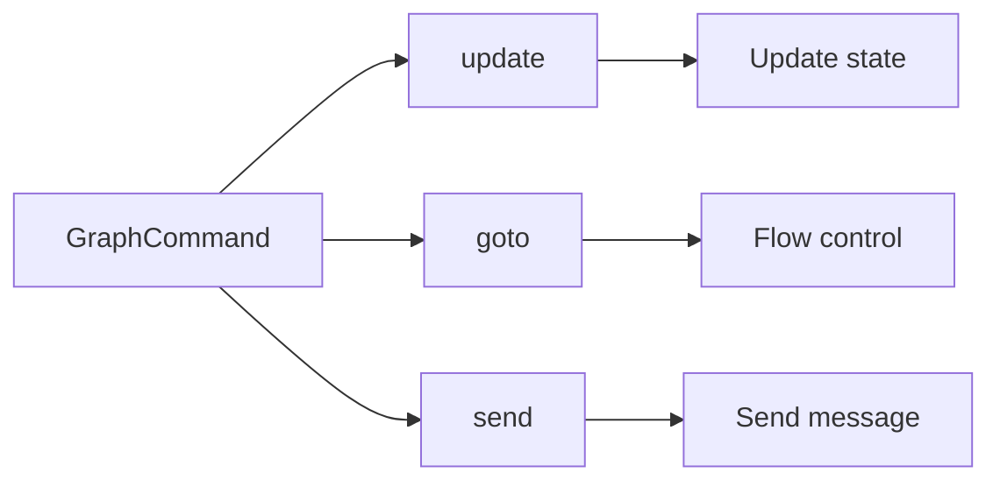
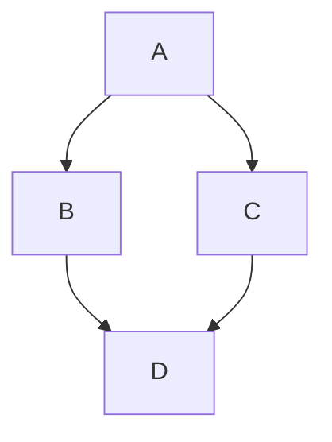
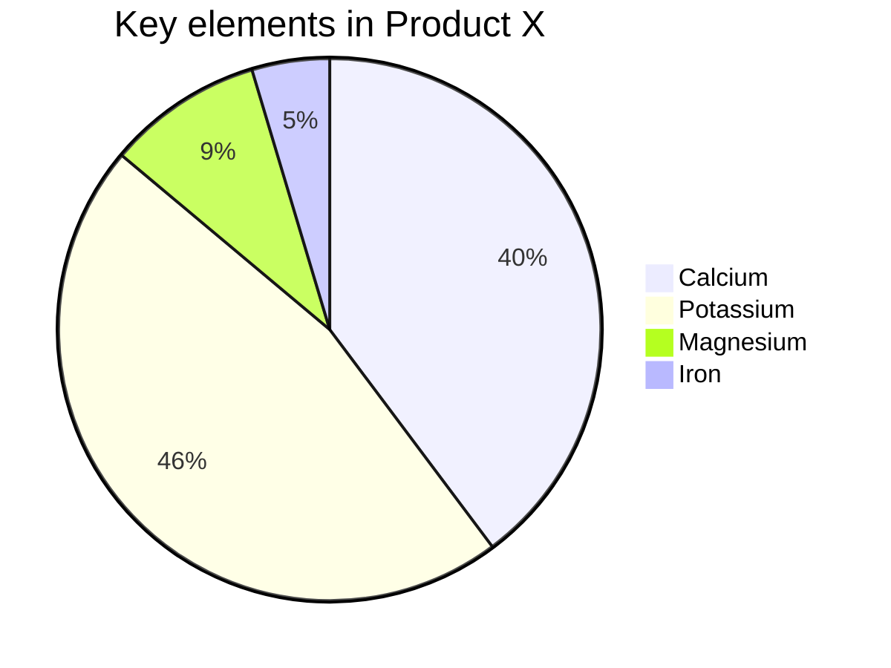
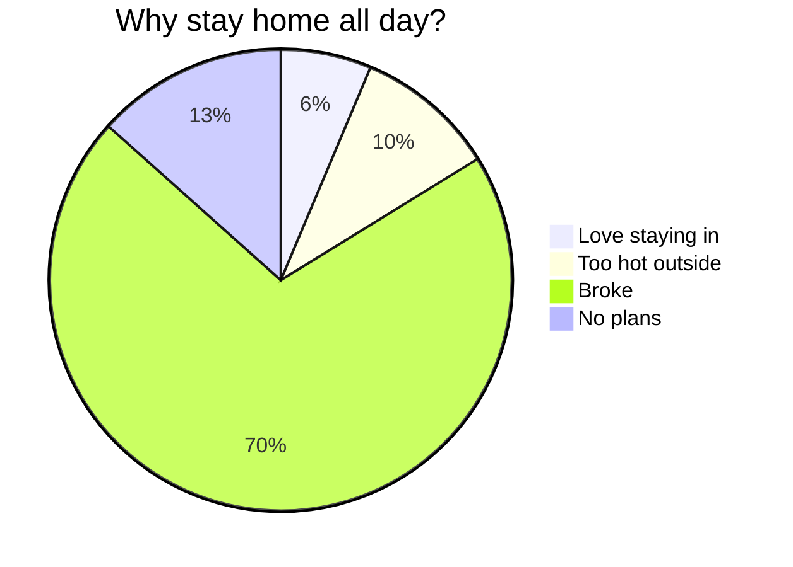
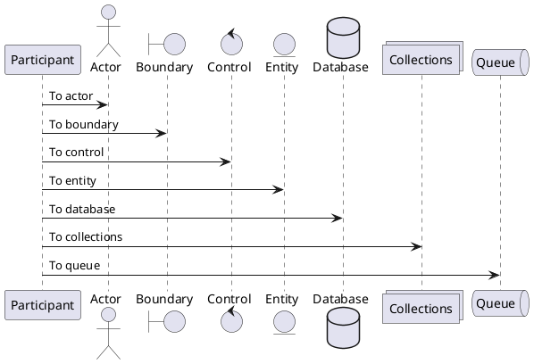

# Explora el maravilloso mundo de Markdown

¡Bienvenido al maravilloso mundo de Markdown! Tanto si escribes, programas, tienes un blog o simplemente quieres anotar algo, Markdown puede ser tu nuevo compañero. Hace que escribir sea simple y claro, y convierte el texto plano en páginas web bonitas con facilidad. Hoy recorreremos la sintaxis básica y la avanzada de Markdown para que disfrutes del camino mientras escribes.

Markdown es un lenguaje de marcado ligero para dar formato al texto plano. Se caracteriza por una sintaxis simple e intuitiva, y puede generar HTML con rapidez. Markdown une lo mejor de la escritura y del código: simple, pero potente.

## Fundamentos de Markdown

### 1. Encabezados: da estructura al contenido

Crea encabezados con `#`. La cantidad de caracteres `#` indica el nivel del encabezado.

```markdown
# Heading 1

## Heading 2

### Heading 3

#### Heading 4
```

El fragmento de arriba muestra una jerarquía clara que mantiene tu contenido organizado.

### 2. Párrafos y saltos de línea: un flujo natural

En Markdown, los párrafos son líneas de texto consecutivas. Para empezar un párrafo nuevo, deja una línea en blanco entre dos bloques de texto.

### 3. Estilos de texto: destaca tus palabras

- **Negrita**: rodea el texto con dos asteriscos o guiones bajos, p. ej. `**negrita**` o `__negrita__`.
- _Cursiva_: rodea el texto con un asterisco o guion bajo, p. ej. `*cursiva*` o `_cursiva_`.
- ~~Tachado~~: rodea el texto con dos virgulillas, p. ej. `~~tachado~~`.
- ==Resaltado==: rodea el texto con dos signos igual, p. ej. `==resaltado==`.
- ++Subrayado++: rodea el texto con dos signos más, p. ej. `++subrayado++`.
- ~Subrayado ondulado~: rodea el texto con una virgulilla, p. ej. `~ondulado~`.

Estas marcas sencillas dan jerarquía y énfasis a tu escritura.

### 4. Listas: claras y ordenadas

- **Lista sin orden**: empieza la línea con `-`, `*` o `+` seguido de un espacio.
- **Lista ordenada**: empieza la línea con un número y un punto (`1.`, `2.`).

¿Necesitas contenido anidado? Sangra para anidar elementos.

- Elemento sin orden 1
  1. Elemento ordenado anidado 1
  2. Elemento ordenado anidado 2
- Elemento sin orden 2

1. Elemento ordenado 1
2. Elemento ordenado 2

### 5. Enlaces e imágenes: enriquece tu contenido

- **Enlace**: usa corchetes y paréntesis: `[texto visible](url)`.
- **Imagen**: igual que un enlace, pero con el prefijo `!`, p. ej. ``.

[Visita Doocs](https://github.com/doocs)


¡Los medios enriquecidos, de forma sencilla!

> Las cuentas oficiales de WeChat solo permiten enlaces a otro contenido de cuentas oficiales. Los enlaces externos pueden parecer enlaces, pero no se pueden abrir.

> Escribe esas URL como texto plano, o activa **Formato → Enlace → cita** para que quien lee vea los destinos al final.

También puedes crear un carrusel horizontal de imágenes con `<,>`, que funciona en las cuentas oficiales de WeChat. Usa imágenes de tamaño parecido para un mejor resultado.

### 6. Citas: frases y reflexiones

Crea una cita con `>`. Para citas anidadas, añade otro `>` en el nivel siguiente.

> Esto es una cita
>
> > Esto es una cita anidada

Las citas anidadas dan más profundidad a tus referencias.

### 7. Bloques de código: muestra tu código

- **Código en línea**: rodéalo con acentos graves, p. ej. `código`.
- **Bloque de código**: rodéalo con tres acentos graves e indica un lenguaje, p. ej.:

```js
console.log(`Hello, Doocs!`)
```

El resaltado de sintaxis hace que el código sea más fácil de leer.

### 8. Líneas horizontales: separa secciones

Crea una línea con tres o más caracteres `-`, `*` o `_`.

---

Añade una separación visual a tu contenido.

### 9. Tablas: presenta los datos con claridad

Markdown admite tablas sencillas con `|` y `-` para separar celdas y encabezados.

| Colaborador                                 | Correo                 | ID de WeChat |
| ------------------------------------------- | ---------------------- | ------------ |
| [yanglbme](https://github.com/yanglbme)     | contact@yanglibin.info | YLB0109      |
| [YangFong](https://github.com/YangFong)     | yangfong2022@gmail.com | yq2419731931 |

¡Las tablas mantienen los datos ordenados y legibles!

> ¿Cansado de escribir el marcado de la tabla a mano? Usa **Editar → Insertar tabla** en el menú superior izquierdo para insertarla rápido.

### 10. Tabla de contenido: navegación generada automáticamente

Pon `[TOC]` en su propia línea para generar una tabla de contenido jerárquica a partir de tus encabezados.

```markdown
[TOC]
```

> Los encabezados de nivel 1 (`#`) se excluyen. Los enlaces de ancla se generan a partir de la posición de cada encabezado en el documento.

## Markdown avanzado

### 1. Fórmulas LaTeX: las matemáticas, bien hechas

Markdown puede incrustar matemáticas en LaTeX:

- **En línea**: rodéalas con `$`, p. ej. $E = mc^2$.
- **En bloque**: rodéalas con `$$`, p. ej.:

$$
\begin{aligned}
d_{i, j} &\leftarrow d_{i, j} + 1 \\
d_{i, y + 1} &\leftarrow d_{i, y + 1} - 1 \\
d_{x + 1, j} &\leftarrow d_{x + 1, j} - 1 \\
d_{x + 1, y + 1} &\leftarrow d_{x + 1, y + 1} + 1
\end{aligned}
$$

También se admiten los delimitadores LaTeX estándar:

- **En línea**: `\(...\)`, p. ej. \(x^2 + y^2 = z^2\).
- **En bloque**: `\[...\]`, p. ej.:

\[
\int_{-\infty}^{\infty} e^{-x^2} dx = \sqrt{\pi}
\]

Puedes mezclar estilos en un mismo párrafo: el clásico $a + b = c$ y LaTeX \(d + e = f\).

1. Fórmula en bloque dentro de una lista 1

$$
\chi^2 = \sum \frac{(O - E)^2}{E}
$$

2. Fórmula en bloque dentro de una lista 2

$$
\chi^2 = \sum \frac{(|O - E| - 0.5)^2}{E}
$$

¡Perfecto para matemáticas complejas!

> [!TIP]
> Pulsa una fórmula LaTeX en la vista previa para abrir el editor de fórmulas, con una biblioteca integrada para editar rápido.

### 2. Diagramas Mermaid: visualiza los flujos

Mermaid te permite crear diagramas de flujo, de secuencia y más dentro de Markdown.









Los diagramas dejan los procesos claros y los documentos más profesionales.

> Más información: [Guía de uso de Mermaid](https://mermaid.js.org/intro/getting-started.html).

### 3. Diagramas PlantUML: visualiza los flujos

PlantUML es otra herramienta potente para diagramas de flujo, de secuencia y más en Markdown.



> Más información: [Página de PlantUML](https://plantuml.com/).

### 4. Infografía: visualiza los datos

¡Un motor de infografías de nueva generación que da vida al texto!

```infographic
infographic list-row-horizontal-icon-arrow
data
  title Customer growth engine
  desc Multi-channel reach and repurchase
  items
    - label Lead acquisition
      value 18.6
      desc Ads and content acquisition
      icon rocket-launch
    - label Conversion lift
      value 12.4
      desc Lead scoring and follow-ups
      icon progress-check
    - label Repurchase
      value 9.8
      desc Membership and benefits
      icon account-sync
    - label Word of mouth
      value 6.2
      desc Community incentives and referrals
      icon account-group
```

> Más información: [Galería de infografías de AntV](https://infographic.antv.vision/gallery).

### 5. Anotaciones ruby: marcado fonético

Se admiten dos formatos:

```md
1. [text]{reading}
2. [text]^(reading)
```

Ejemplos renderizados:

[你好]{nǐ hǎo} [世界]{shì jiè}

Separadores admitidos: `・` (punto medio), `．` (punto de ancho completo), `。` (punto CJK), `-` (guion)

Ejemplos:

```md
[你好世界]{nǐ・hǎo・shì・jiè}
[小夜時雨]^(さ・よ・しぐれ)
```

[你好世界]{nǐ・hǎo・shì・jiè}
[小夜時雨]^(さ・よ・しぐれ)

Si el número de sílabas y el de separadores no coinciden, se elige automáticamente el ajuste más cercano.

```md
[小夜時雨]{さ・よ・しぐれ}
[小夜時雨]{さ・よ}
[小夜]{さ・よ・しぐれ}
[小夜時雨]{さ・よ・しぐれ・extra}
```

[小夜時雨]{さ・よ・しぐれ}
[小夜時雨]{さ・よ}
[小夜]{さ・よ・しぐれ}
[小夜時雨]{さ・よ・しぐれ・extra}

### 6. Avisos y entornos: destaca lo importante

Usa `> [!tipo]` o `::: tipo ... :::` para crear avisos con estilo. Puedes añadir un **título personalizado** después del tipo; el cuerpo admite Markdown completo y matemáticas.

Tipos de aviso habituales:

> [!NOTE]
> Información que conviene notar aunque se lea por encima.

> [!TIP]
> Consejos útiles que facilitan una tarea.

> [!IMPORTANT] Léelo antes de publicar
> Un título personalizado después del tipo sustituye al predeterminado.

> [!WARNING]
> Contenido crítico que necesita atención inmediata.

La sintaxis de contenedor funciona igual:

::: tip
Este consejo usa la sintaxis de contenedor.
:::

Los entornos académicos integrados (teorema, lema, definición y más) también admiten fórmulas en el cuerpo:

::: theorem teorema de Pitágoras
En un triángulo rectángulo, el cuadrado de la hipotenusa es igual a la suma de los cuadrados de los otros dos lados: $a^2 + b^2 = c^2$.
:::

::: definition
Si para todo $\varepsilon > 0$ existe un $\delta > 0$ tal que $0 < |x - a| < \delta$ implica $|f(x) - L| < \varepsilon$, entonces $\lim_{x \to a} f(x) = L$.
:::

::: proof
Se sigue directamente de la definición anterior. C.Q.D.
:::

El nombre del tipo puede ser **cualquier texto**. Los tipos no reconocidos usan un estilo predeterminado y el nombre como título:

::: Corolario
Cualquier nombre se muestra como un recuadro con título.
:::

## Cierre

Markdown es un lenguaje de marcado simple, potente y fácil de aprender. Con lo básico y las funciones avanzadas de arriba, puedes crear contenido rápido y comunicarte con claridad, ya sea para documentación técnica, un blog personal o notas de un proyecto. Esperamos que esta guía te ayude a aprovechar el potencial de Markdown y a disfrutar más al escribir.

Abre tu editor Markdown y empieza a crear. Explora Markdown: es más agradable de lo que imaginas.

### Lecturas recomendadas

- [Otro proyecto de código abierto de Alibaba supera las 20k estrellas: ¡felicidades, fastjson!](https://mp.weixin.qq.com/s/RNKDCK2KoyeuMeEs6GUrow)
- [Preguntas de entrevista sobre datos masivos de las grandes tecnológicas que eliminan al 90 % de los candidatos](https://mp.weixin.qq.com/s/rjGqxUvrEqJNlo09GrT1Dw)
- [Cómo ayudan de verdad los bloques de texto en Java 13](https://mp.weixin.qq.com/s/kalGv5T8AZGxTnLHr2wDsA)
- [Ranking de contribuciones de GitHub en 2019: Microsoft y Google lideran, y Alibaba queda entre los 12 primeros](https://mp.weixin.qq.com/s/_q812aGD1b9QvZ2WFI0Qgw)

---

<center>
    
</center>
