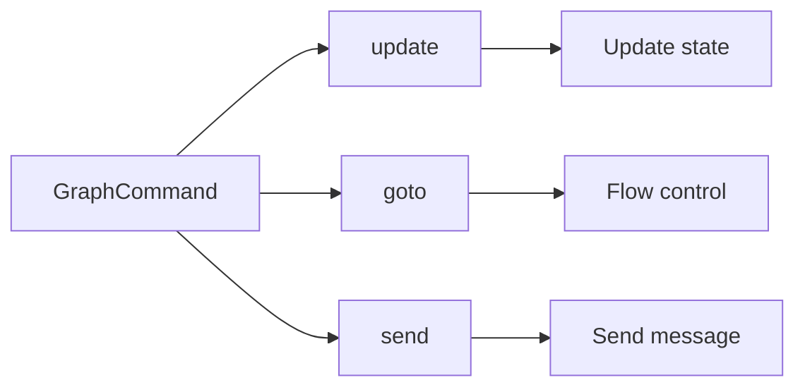
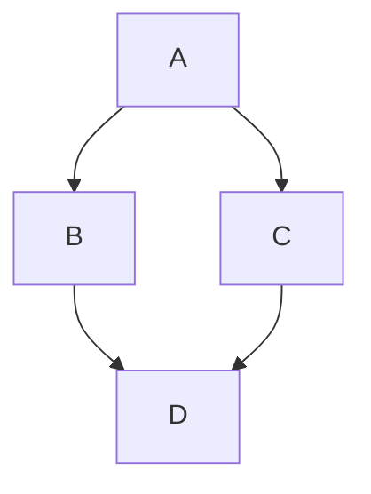
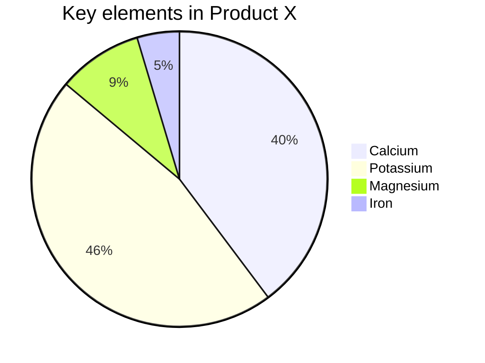
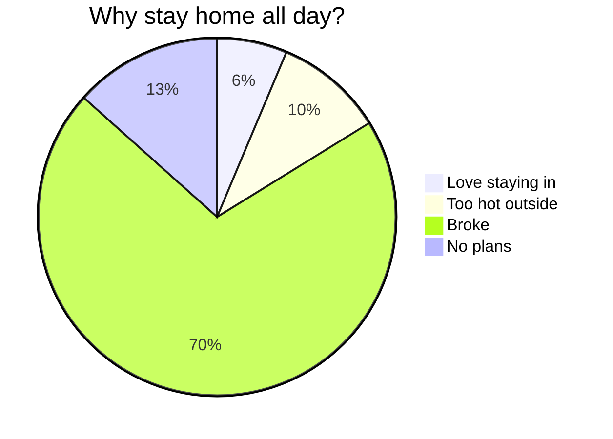
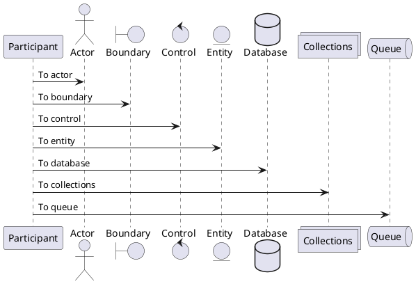

# Explorez le monde merveilleux de Markdown

Bienvenue dans le monde merveilleux de Markdown ! Que tu sois auteur, développeur, blogueur, ou simplement quelqu'un qui veut noter quelques idées, Markdown peut devenir ton nouveau compagnon. Il rend l'écriture simple et claire, et transforme facilement du texte brut en belles pages web. Aujourd'hui, nous parcourons les bases et la syntaxe avancée de Markdown pour que tu prennes plaisir à écrire en chemin.

Markdown est un langage de balisage léger pour mettre en forme du texte brut. Connu pour sa syntaxe simple et intuitive, il peut générer du HTML rapidement. Markdown est le mélange parfait de l'écriture et du code : simple, et pourtant puissant.

## Les bases de Markdown

### 1. Titres : structure ton contenu

Crée des titres avec `#`. Le nombre de caractères `#` indique le niveau du titre.

```markdown
# Heading 1

## Heading 2

### Heading 3

#### Heading 4
```

L'extrait ci-dessus produit une hiérarchie claire qui garde ton contenu organisé.

### 2. Paragraphes et sauts de ligne : un flux naturel

En Markdown, un paragraphe est une suite de lignes de texte. Pour commencer un nouveau paragraphe, laisse une ligne vide entre deux blocs de texte.

### 3. Styles de texte : mets tes mots en valeur

- **Gras** : entoure le texte de deux astérisques ou de deux traits de soulignement, p. ex. `**gras**` ou `__gras__`.
- _Italique_ : entoure le texte d'un astérisque ou d'un trait de soulignement, p. ex. `*italique*` ou `_italique_`.
- ~~Barré~~ : entoure le texte de deux tildes, p. ex. `~~barré~~`.
- ==Surligné== : entoure le texte de deux signes égal, p. ex. `==surligné==`.
- ++Souligné++ : entoure le texte de deux signes plus, p. ex. `++souligné++`.
- ~Soulignement ondulé~ : entoure le texte d'un tilde, p. ex. `~ondulé~`.

Ces marques simples ajoutent de la hiérarchie et de l'emphase à ton écriture.

### 4. Listes : nettes et ordonnées

- **Liste non ordonnée** : commence une ligne par `-`, `*` ou `+`, suivi d'un espace.
- **Liste ordonnée** : commence une ligne par un nombre et un point (`1.`, `2.`).

Besoin d'imbriquer du contenu ? Décale les lignes pour imbriquer les éléments.

- Élément non ordonné 1
  1. Élément ordonné imbriqué 1
  2. Élément ordonné imbriqué 2
- Élément non ordonné 2

1. Élément ordonné 1
2. Élément ordonné 2

### 5. Liens et images : enrichis ton contenu

- **Lien** : utilise des crochets et des parenthèses — `[texte affiché](url)`.
- **Image** : comme un lien, précédé de `!`, p. ex. ``.

[Voir Doocs](https://github.com/doocs)


Des médias riches, en toute simplicité !

> Les comptes officiels WeChat n'autorisent que les liens vers d'autres contenus de comptes officiels. Les liens externes peuvent ressembler à des liens, mais ne s'ouvrent pas.

> Écris ces URL en texte brut, ou active **Format → Convertir les liens WeChat externes en notes** pour que les lecteurs voient les destinations en bas de page.

Tu peux aussi créer un diaporama horizontal d'images avec `<,>`, qui fonctionne sur les comptes officiels WeChat. Utilise des images de taille similaire pour un meilleur résultat.

### 6. Citations : extraits et phrases qui font réfléchir

Crée une citation avec `>`. Pour une citation imbriquée, ajoute un autre `>` au niveau suivant.

> Ceci est une citation
>
> > Ceci est une citation imbriquée

Les citations imbriquées donnent plus de profondeur à tes références.

### 7. Blocs de code : montre ton code

- **Code en ligne** : entoure avec des accents graves, p. ex. `code`.
- **Bloc de code** : entoure avec trois backticks et indique un langage, p. ex. :

```js
console.log(`Hello, Doocs!`)
```

La coloration syntaxique rend le code plus facile à lire.

### 8. Filets horizontaux : sépare les sections

Crée un filet avec trois caractères `-`, `*` ou `_` ou plus.

---

Ajoute une séparation visuelle à ton contenu.

### 9. Tableaux : présente les données clairement

Markdown prend en charge des tableaux simples avec `|` et `-` pour séparer les cellules et les en-têtes.

| Contributeur                                | E-mail                 | ID WeChat    |
| ------------------------------------------- | ---------------------- | ------------ |
| [yanglbme](https://github.com/yanglbme)     | contact@yanglibin.info | YLB0109      |
| [YangFong](https://github.com/YangFong)     | yangfong2022@gmail.com | yq2419731931 |

Les tableaux gardent les données nettes et lisibles !

> Fatigué d'écrire le balisage des tableaux à la main ? Utilise **Édition → Insérer un tableau** dans le menu en haut à gauche pour une insertion rapide.

### 10. Table des matières : une navigation générée automatiquement

Place `[TOC]` sur sa propre ligne pour générer une table des matières hiérarchique à partir de tes titres.

```markdown
[TOC]
```

> Les titres de niveau 1 (`#`) sont exclus. Les liens d'ancrage sont générés à partir de la position de chaque titre dans le document.

## Markdown avancé

### 1. Formules LaTeX : les maths, comme il faut

Markdown peut intégrer des maths en LaTeX :

- **En ligne** : entoure avec `$`, p. ex. $E = mc^2$.
- **En bloc** : entoure avec `$$`, p. ex. :

$$
\begin{aligned}
d_{i, j} &\leftarrow d_{i, j} + 1 \\
d_{i, y + 1} &\leftarrow d_{i, y + 1} - 1 \\
d_{x + 1, j} &\leftarrow d_{x + 1, j} - 1 \\
d_{x + 1, y + 1} &\leftarrow d_{x + 1, y + 1} + 1
\end{aligned}
$$

Les délimiteurs LaTeX standard sont aussi pris en charge :

- **En ligne** : `\(...\)`, p. ex. \(x^2 + y^2 = z^2\).
- **En bloc** : `\[...\]`, p. ex. :

\[
\int\_{-\infty}^{\infty} e^{-x^2} dx = \sqrt{\pi}
\]

Tu peux mélanger les styles dans un même paragraphe : le classique $a + b = c$ et le LaTeX \(d + e = f\).

1. Formule en bloc dans une liste 1

$$
\chi^2 = \sum \frac{(O - E)^2}{E}
$$

2. Formule en bloc dans une liste 2

$$
\chi^2 = \sum \frac{(|O - E| - 0.5)^2}{E}
$$

Parfait pour les maths complexes !

> [!TIP]
> Clique sur une formule LaTeX dans l'aperçu pour ouvrir l'éditeur de formules, avec une bibliothèque de formules intégrée pour des modifications rapides.

### 2. Diagrammes Mermaid : visualise les flux

Mermaid te permet de créer des organigrammes, des diagrammes de séquence et plus encore dans Markdown.









Les diagrammes rendent les processus clairs et les documents plus professionnels.

> Pour aller plus loin : [Guide d'utilisation Mermaid](https://mermaid.js.org/intro/getting-started.html).

### 3. Diagrammes PlantUML : visualise les flux

PlantUML est un autre outil puissant pour les organigrammes, les diagrammes de séquence et plus encore dans Markdown.



> Pour aller plus loin : [Page d'accueil PlantUML](https://plantuml.com/).

### 4. Infographic : visualise les données

Un moteur d'infographies de nouvelle génération qui donne vie au texte !

```infographic
infographic list-row-horizontal-icon-arrow
data
  title Customer growth engine
  desc Multi-channel reach and repurchase
  items
    - label Lead acquisition
      value 18.6
      desc Ads and content acquisition
      icon rocket-launch
    - label Conversion lift
      value 12.4
      desc Lead scoring and follow-ups
      icon progress-check
    - label Repurchase
      value 9.8
      desc Membership and benefits
      icon account-sync
    - label Word of mouth
      value 6.2
      desc Community incentives and referrals
      icon account-group
```

> Pour aller plus loin : [Galerie AntV Infographic](https://infographic.antv.vision/gallery).

### 5. Annotations ruby : balisage phonétique

Deux formats sont pris en charge :

```md
1. [text]{reading}
2. [text]^(reading)
```

Exemples rendus :

[你好]{nǐ hǎo} [世界]{shì jiè}

Séparateurs pris en charge : `・` (point médian), `．` (point pleine chasse), `。` (point CJK), `-` (trait d'union)

Exemples :

```md
[你好世界]{nǐ・hǎo・shì・jiè}
[小夜時雨]^(さ・よ・しぐれ)
```

[你好世界]{nǐ・hǎo・shì・jiè}
[小夜時雨]^(さ・よ・しぐれ)

Quand le nombre de syllabes et de séparateurs ne correspond pas, l'ajustement le plus proche est choisi automatiquement.

```md
[小夜時雨]{さ・よ・しぐれ}
[小夜時雨]{さ・よ}
[小夜]{さ・よ・しぐれ}
[小夜時雨]{さ・よ・しぐれ・extra}
```

[小夜時雨]{さ・よ・しぐれ}
[小夜時雨]{さ・よ}
[小夜]{さ・よ・しぐれ}
[小夜時雨]{さ・よ・しぐれ・extra}

### 6. Encadrés et environnements : mets en avant l'essentiel

Utilise `> [!type]` ou `::: type ... :::` pour créer des encadrés stylés. Tu peux ajouter un **titre personnalisé** après le type ; le corps prend en charge tout le Markdown et les maths.

Types d'encadrés courants :

> [!NOTE]
> Une information que les lecteurs doivent remarquer, même en survolant.

> [!TIP]
> Des conseils utiles qui facilitent une tâche.

> [!IMPORTANT] À lire avant publication
> Un titre personnalisé après le type remplace le titre par défaut.

> [!WARNING]
> Un contenu critique qui demande une attention immédiate.

La syntaxe conteneur fonctionne de la même façon :

::: tip
Cette astuce utilise la syntaxe conteneur.
:::

Les environnements académiques intégrés (théorème, lemme, définition, et plus) acceptent aussi des formules dans le corps :

::: theorem Théorème de Pythagore
Dans un triangle rectangle, le carré de l'hypoténuse est égal à la somme des carrés des deux autres côtés : $a^2 + b^2 = c^2$.
:::

::: definition
Si pour tout $\varepsilon > 0$ il existe $\delta > 0$ tel que $0 < |x - a| < \delta$ implique $|f(x) - L| < \varepsilon$, alors $\lim_{x \to a} f(x) = L$.
:::

::: proof
Découle directement de la définition ci-dessus. CQFD.
:::

Le nom du type peut être **n'importe quel texte**. Les types non reconnus utilisent un style par défaut, avec le nom comme titre :

::: Corollaire
N'importe quel nom s'affiche comme un encadré titré.
:::

## Pour finir

Markdown est un langage de balisage simple, puissant et facile à apprendre. Avec les bases et les fonctions avancées ci-dessus, tu peux créer du contenu rapidement et communiquer clairement, que ce soit pour une documentation technique, un blog personnel ou des notes de projet. Nous espérons que ce guide t'aide à révéler le potentiel de Markdown et à rendre l'écriture plus agréable.

Ouvre ton éditeur Markdown et commence à créer. Explore Markdown : c'est plus plaisant que tu ne l'imagines !

### Pour aller plus loin

- [Un autre projet open source d'Alibaba dépasse les 20k étoiles — bravo, fastjson !](https://mp.weixin.qq.com/s/RNKDCK2KoyeuMeEs6GUrow)
- [Des questions d'entretien des grandes entreprises tech sur les données massives, qui éliminent 90 % des candidats](https://mp.weixin.qq.com/s/rjGqxUvrEqJNlo09GrT1Dw)
- [À quoi servent vraiment les blocs de texte de Java 13](https://mp.weixin.qq.com/s/kalGv5T8AZGxTnLHr2wDsA)
- [Classement 2019 des contributions GitHub — Microsoft et Google en tête, Alibaba parmi les 12 premiers](https://mp.weixin.qq.com/s/_q812aGD1b9QvZ2WFI0Qgw)

---

<center>
    
</center>
