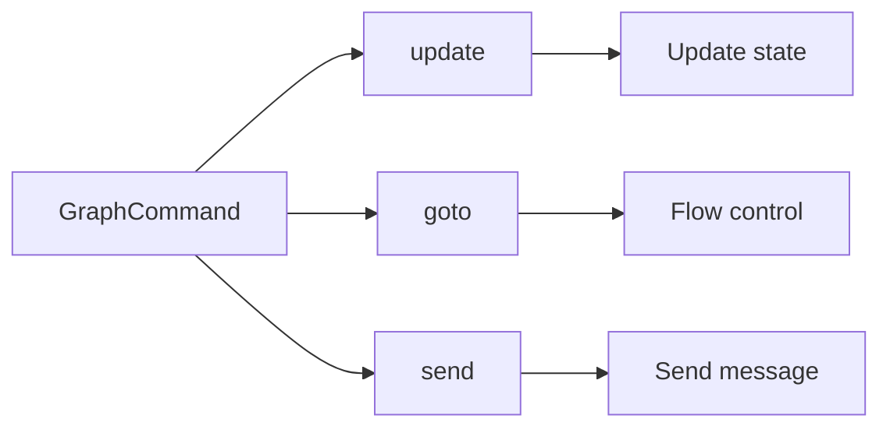
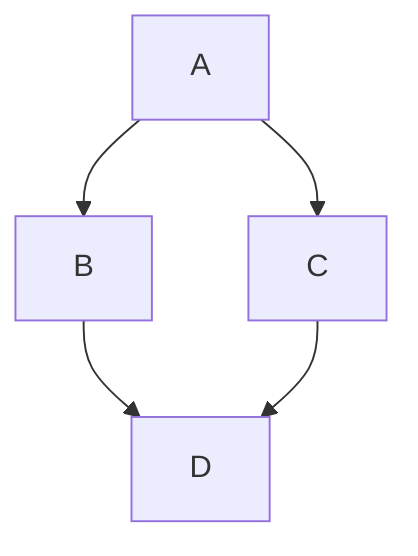
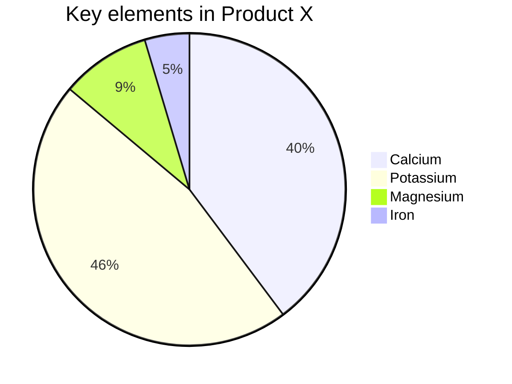
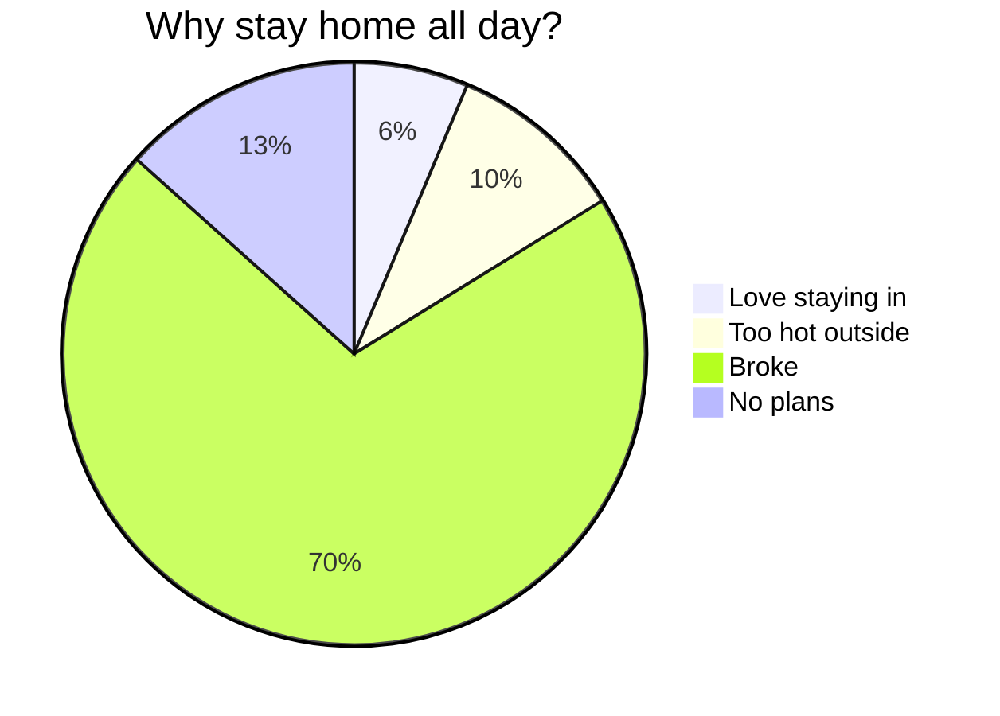
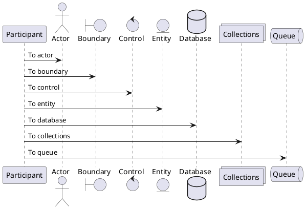

# Explore o maravilhoso mundo do Markdown

Bem-vindo ao maravilhoso mundo do Markdown! Seja você escritor, desenvolvedor, blogueiro ou alguém que só quer anotar ideias, o Markdown pode ser seu novo companheiro. Ele torna a escrita simples e clara e transforma texto puro em páginas bonitas com facilidade. Hoje vamos percorrer a sintaxe básica e a avançada do Markdown para você aproveitar o caminho enquanto escreve.

O Markdown é uma linguagem de marcação leve para formatar texto puro. Conhecido pela sintaxe simples e intuitiva, ele gera HTML rapidamente. O Markdown é a combinação perfeita de escrita e código: simples e poderoso.

## Fundamentos do Markdown

### 1. Títulos: estruture o conteúdo

Crie títulos com `#`. A quantidade de caracteres `#` indica o nível do título.

```markdown
# Heading 1

## Heading 2

### Heading 3

#### Heading 4
```

O trecho acima gera uma hierarquia clara que mantém o conteúdo organizado.

### 2. Parágrafos e quebras de linha: fluxo natural

No Markdown, parágrafos são linhas consecutivas de texto. Para começar um novo parágrafo, deixe uma linha em branco entre dois blocos de texto.

### 3. Estilos de texto: dê ênfase às palavras

- **Negrito**: envolva o texto com dois asteriscos ou sublinhados, ex.: `**negrito**` ou `__negrito__`.
- _Itálico_: envolva o texto com um asterisco ou sublinhado, ex.: `*itálico*` ou `_itálico_`.
- ~~Tachado~~: envolva o texto com dois tils, ex.: `~~tachado~~`.
- ==Destaque==: envolva o texto com dois sinais de igual, ex.: `==destaque==`.
- ++Sublinhado++: envolva o texto com dois sinais de mais, ex.: `++sublinhado++`.
- ~Sublinhado ondulado~: envolva o texto com um til, ex.: `~ondulado~`.

Essas marcas simples dão hierarquia e ênfase à sua escrita.

### 4. Listas: limpas e ordenadas

- **Lista não ordenada**: comece a linha com `-`, `*` ou `+` seguido de um espaço.
- **Lista ordenada**: comece a linha com um número e um ponto (`1.`, `2.`).

Precisa de conteúdo aninhado? Indente para aninhar os itens.

- Item não ordenado 1
  1. Item ordenado aninhado 1
  2. Item ordenado aninhado 2
- Item não ordenado 2

1. Item ordenado 1
2. Item ordenado 2

### 5. Links e imagens: enriqueça o conteúdo

- **Link**: use colchetes e parênteses — `[texto de exibição](url)`.
- **Imagem**: igual a um link, mas com `!` na frente, ex.: ``.

[Visite o Doocs](https://github.com/doocs)


Mídia rica, de um jeito simples!

> Contas oficiais do WeChat só permitem links para outros conteúdos de contas oficiais. Links externos podem parecer links, mas não abrem.

> Escreva essas URLs como texto puro ou ative **Formato → Converter links externos do WeChat em notas de rodapé** para os leitores verem os destinos no final.

Você também pode criar um carrossel horizontal de imagens com `<,>`, que funciona em contas oficiais do WeChat. Use imagens de tamanho parecido para o melhor resultado.

### 6. Citações: frases e reflexões

Crie uma citação com `>`. Para citações aninhadas, acrescente outro `>` no nível seguinte.

> Esta é uma citação
>
> > Esta é uma citação aninhada

Citações aninhadas dão mais profundidade às suas referências.

### 7. Blocos de código: mostre seu código

- **Código inline**: envolva com crases, ex.: `código`.
- **Bloco de código**: envolva com três crases e indique a linguagem, ex.:

```js
console.log(`Hello, Doocs!`)
```

O realce de sintaxe deixa o código mais fácil de ler.

### 8. Linhas horizontais: separe as seções

Crie uma linha com três ou mais caracteres `-`, `*` ou `_`.

---

Dê uma separação visual ao conteúdo.

### 9. Tabelas: apresente dados com clareza

O Markdown aceita tabelas simples com `|` e `-` para separar células e cabeçalhos.

| Colaborador                                 | E-mail                 | ID do WeChat |
| ------------------------------------------- | ---------------------- | ------------ |
| [yanglbme](https://github.com/yanglbme)     | contact@yanglibin.info | YLB0109      |
| [YangFong](https://github.com/YangFong)     | yangfong2022@gmail.com | yq2419731931 |

Tabelas deixam os dados organizados e fáceis de ler!

> Cansou de escrever a marcação da tabela à mão? Use **Editar → Inserir tabela** no menu superior esquerdo para inserir rápido.

### 10. Sumário: navegação gerada automaticamente

Coloque `[TOC]` em uma linha própria para gerar um sumário hierárquico a partir dos títulos.

```markdown
[TOC]
```

> Títulos de nível 1 (`#`) ficam de fora. Os links âncora são gerados a partir da posição de cada título no documento.

## Markdown avançado

### 1. Fórmulas LaTeX: matemática do jeito certo

O Markdown pode incorporar matemática em LaTeX:

- **Em linha**: envolva com `$`, ex.: $E = mc^2$.
- **Bloco**: envolva com `$$`, ex.:

$$
\begin{aligned}
d_{i, j} &\leftarrow d_{i, j} + 1 \\
d_{i, y + 1} &\leftarrow d_{i, y + 1} - 1 \\
d_{x + 1, j} &\leftarrow d_{x + 1, j} - 1 \\
d_{x + 1, y + 1} &\leftarrow d_{x + 1, y + 1} + 1
\end{aligned}
$$

Delimitadores LaTeX padrão também são aceitos:

- **Em linha**: `\(...\)`, ex.: \(x^2 + y^2 = z^2\).
- **Bloco**: `\[...\]`, ex.:

\[
\int\_{-\infty}^{\infty} e^{-x^2} dx = \sqrt{\pi}
\]

Você pode misturar os estilos no mesmo parágrafo: o clássico $a + b = c$ e o LaTeX \(d + e = f\).

1. Fórmula em bloco dentro de uma lista 1

$$
\chi^2 = \sum \frac{(O - E)^2}{E}
$$

2. Fórmula em bloco dentro de uma lista 2

$$
\chi^2 = \sum \frac{(|O - E| - 0.5)^2}{E}
$$

Perfeito para matemática complexa!

> [!TIP]
> Clique em uma fórmula LaTeX na prévia para abrir o editor de fórmulas, com uma biblioteca integrada para edições rápidas.

### 2. Diagramas Mermaid: visualize fluxos

O Mermaid permite criar fluxogramas, diagramas de sequência e muito mais dentro do Markdown.









Diagramas deixam os processos claros e os documentos mais profissionais.

> Saiba mais: [Guia do usuário do Mermaid](https://mermaid.js.org/intro/getting-started.html).

### 3. Diagramas PlantUML: visualize fluxos

O PlantUML é outra ferramenta poderosa para fluxogramas, diagramas de sequência e muito mais no Markdown.



> Saiba mais: [Página inicial do PlantUML](https://plantuml.com/).

### 4. Infográfico: visualize dados

Um motor de infográficos de nova geração que dá vida ao texto!

```infographic
infographic list-row-horizontal-icon-arrow
data
  title Customer growth engine
  desc Multi-channel reach and repurchase
  items
    - label Lead acquisition
      value 18.6
      desc Ads and content acquisition
      icon rocket-launch
    - label Conversion lift
      value 12.4
      desc Lead scoring and follow-ups
      icon progress-check
    - label Repurchase
      value 9.8
      desc Membership and benefits
      icon account-sync
    - label Word of mouth
      value 6.2
      desc Community incentives and referrals
      icon account-group
```

> Saiba mais: [Galeria de infográficos do AntV](https://infographic.antv.vision/gallery).

### 5. Anotações ruby: marcação fonética

Dois formatos são aceitos:

```md
1. [text]{reading}
2. [text]^(reading)
```

Exemplos renderizados:

[你好]{nǐ hǎo} [世界]{shì jiè}

Separadores aceitos: `・` (ponto médio), `．` (ponto de largura total), `。` (ponto CJK), `-` (hífen)

Exemplos:

```md
[你好世界]{nǐ・hǎo・shì・jiè}
[小夜時雨]^(さ・よ・しぐれ)
```

[你好世界]{nǐ・hǎo・shì・jiè}
[小夜時雨]^(さ・よ・しぐれ)

Quando a quantidade de sílabas e separadores não coincide, o encaixe mais próximo é escolhido automaticamente.

```md
[小夜時雨]{さ・よ・しぐれ}
[小夜時雨]{さ・よ}
[小夜]{さ・よ・しぐれ}
[小夜時雨]{さ・よ・しぐれ・extra}
```

[小夜時雨]{さ・よ・しぐれ}
[小夜時雨]{さ・よ}
[小夜]{さ・よ・しぐれ}
[小夜時雨]{さ・よ・しぐれ・extra}

### 6. Destaques e ambientes: realce os pontos principais

Use `> [!tipo]` ou `::: tipo ... :::` para criar destaques com estilo. Você pode acrescentar um **título personalizado** depois do tipo; o corpo aceita Markdown completo e matemática.

Tipos comuns de destaque:

> [!NOTE]
> Informação que o leitor deve notar mesmo numa leitura rápida.

> [!TIP]
> Dicas úteis que facilitam uma tarefa.

> [!IMPORTANT] Leia antes de publicar
> Um título personalizado depois do tipo substitui o padrão.

> [!WARNING]
> Conteúdo crítico que precisa de atenção imediata.

A sintaxe de contêiner funciona do mesmo jeito:

::: tip
Esta dica usa a sintaxe de contêiner.
:::

Ambientes acadêmicos integrados (teorema, lema, definição e outros) também aceitam fórmulas no corpo:

::: theorem Teorema de Pitágoras
Em um triângulo retângulo, o quadrado da hipotenusa é igual à soma dos quadrados dos outros dois lados: $a^2 + b^2 = c^2$.
:::

::: definition
Se para todo $\varepsilon > 0$ existe $\delta > 0$ tal que $0 < |x - a| < \delta$ implica $|f(x) - L| < \varepsilon$, então $\lim_{x \to a} f(x) = L$.
:::

::: proof
Segue diretamente da definição acima. C.Q.D.
:::

O nome do tipo pode ser **qualquer texto**. Tipos não reconhecidos usam um estilo padrão com o nome como título:

::: Corolário
Qualquer nome é renderizado como uma caixa com título.
:::

## Encerramento

O Markdown é uma linguagem de marcação simples, poderosa e fácil de aprender. Com o básico e os recursos avançados acima, você cria conteúdo rápido e se comunica com clareza — em documentação técnica, um blog pessoal ou notas de projeto. Esperamos que este guia ajude você a descobrir o potencial do Markdown e tornar a escrita mais prazerosa.

Abra seu editor Markdown e comece a criar. Explore o Markdown — ele é mais encantador do que você imagina!

### Leitura adicional

- [Mais um projeto open source da Alibaba passa de 20 mil estrelas — parabéns, fastjson!](https://mp.weixin.qq.com/s/RNKDCK2KoyeuMeEs6GUrow)
- [Perguntas de entrevista sobre dados em massa das big techs que eliminam 90% dos candidatos](https://mp.weixin.qq.com/s/rjGqxUvrEqJNlo09GrT1Dw)
- [Como os blocos de texto do Java 13 realmente ajudam](https://mp.weixin.qq.com/s/kalGv5T8AZGxTnLHr2wDsA)
- [Ranking de contribuições do GitHub em 2019 — Microsoft e Google na frente, Alibaba no top 12](https://mp.weixin.qq.com/s/_q812aGD1b9QvZ2WFI0Qgw)

---

<center>
    
</center>
