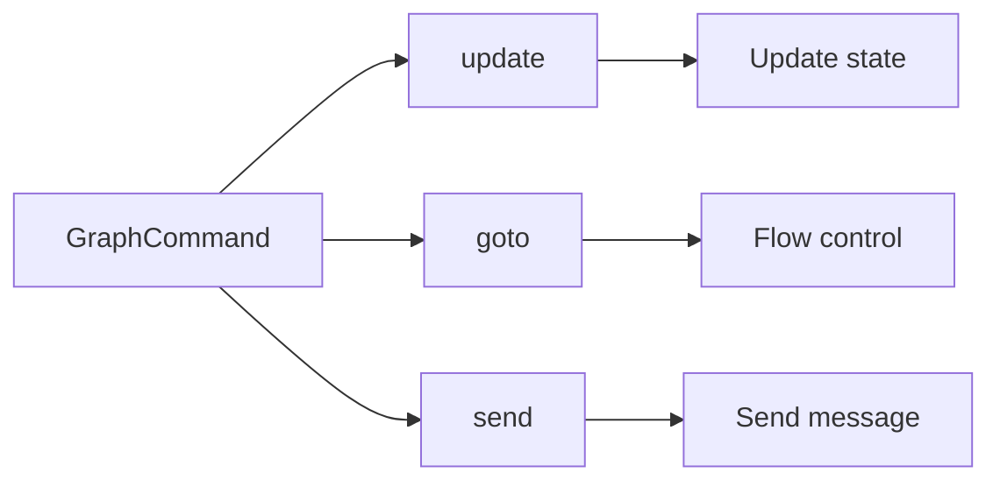
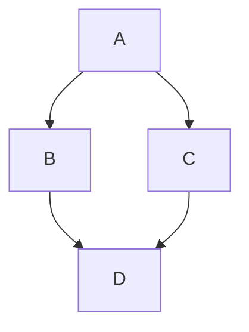
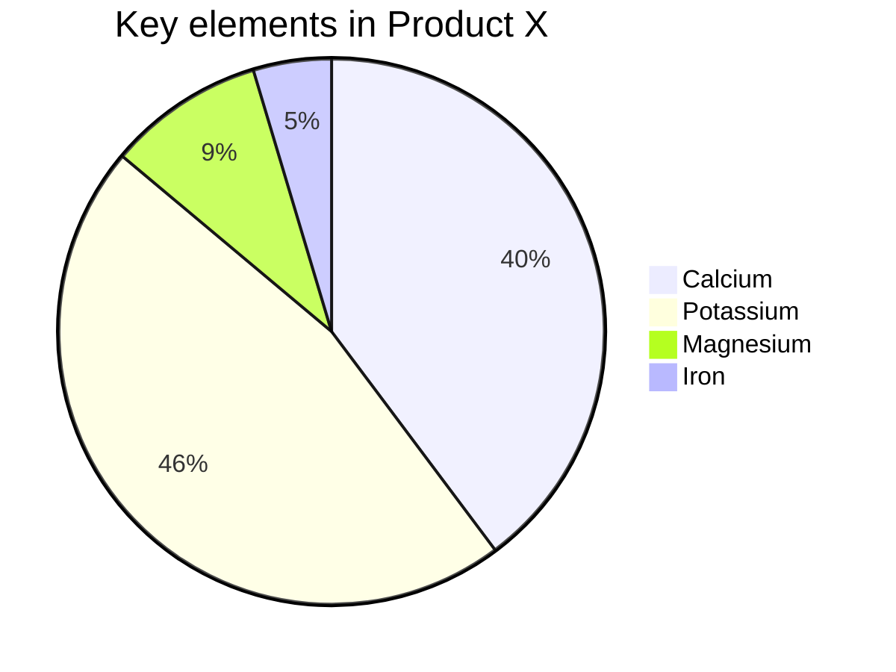
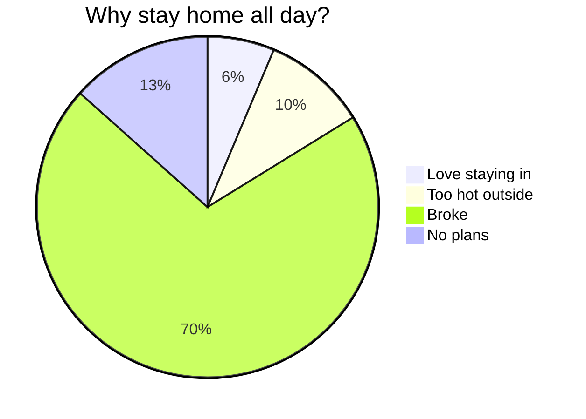
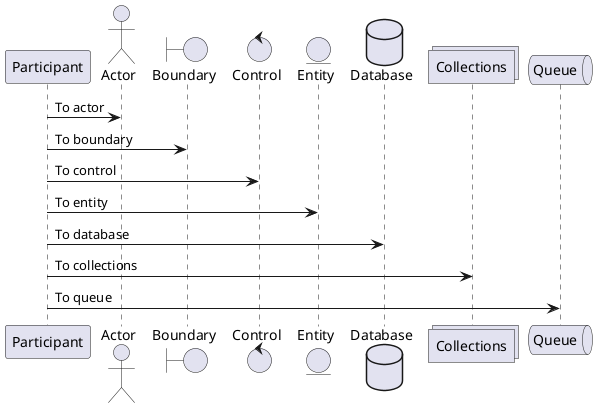

# Исследуйте удивительный мир Markdown

Добро пожаловать в удивительный мир Markdown! Пишете ли вы, разрабатываете, ведёте блог или просто хотите набросать заметку — Markdown станет вашим новым спутником. Он делает письмо простым и ясным и легко превращает обычный текст в красивые веб-страницы. Сегодня мы разберём основы и расширенный синтаксис Markdown, чтобы по пути вам было приятно писать.

Markdown — лёгкий язык разметки для оформления простого текста. Его ценят за простой и понятный синтаксис, с которым можно быстро получить HTML. Markdown удачно соединяет текст и код: он прост и при этом силён.

## Основы Markdown

### 1. Заголовки: структура текста

Заголовки создаются символом `#`. Число символов `#` задаёт уровень заголовка.

```markdown
# Heading 1

## Heading 2

### Heading 3

#### Heading 4
```

Фрагмент выше даёт ясную иерархию и помогает упорядочить текст.

### 2. Абзацы и переносы строк: естественный ритм

В Markdown абзац — это идущие подряд строки текста. Чтобы начать новый абзац, оставьте пустую строку между двумя блоками.

### 3. Начертание: расставьте акценты

- **Жирный**: заключите текст в две звёздочки или два подчёркивания, например `**жирный**` или `__жирный__`.
- _Курсив_: одна звёздочка или одно подчёркивание, например `*курсив*` или `_курсив_`.
- ~~Зачёркнутый~~: две тильды, например `~~зачёркнутый~~`.
- ==Выделение==: два знака равенства, например `==выделение==`.
- ++Подчёркнутый++: два плюса, например `++подчёркнутый++`.
- ~Волнистое подчёркивание~: одна тильда, например `~волна~`.

Эти простые знаки добавляют тексту иерархию и акценты.

### 4. Списки: порядок и ясность

- **Маркированный список**: начните строку с `-`, `*` или `+` и пробела.
- **Нумерованный список**: начните строку с числа и точки (`1.`, `2.`).

Нужна вложенность? Сделайте отступ.

- Маркированный пункт 1
  1. Вложенный нумерованный пункт 1
  2. Вложенный нумерованный пункт 2
- Маркированный пункт 2

1. Нумерованный пункт 1
2. Нумерованный пункт 2

### 5. Ссылки и изображения: насыщенный текст

- **Ссылка**: квадратные и круглые скобки — `[текст ссылки](url)`.
- **Изображение**: как ссылка, но с `!` в начале, например ``.

[Перейти к Doocs](https://github.com/doocs)


Насыщенные материалы — без лишней сложности!

> Официальные аккаунты WeChat разрешают ссылки только на материалы других официальных аккаунтов. Внешние ссылки могут выглядеть как ссылки, но открыть их нельзя.

> Записывайте такие URL обычным текстом или включите **Формат → Преобразовать внешние ссылки WeChat в сноски**, чтобы читатели видели адреса внизу.

Горизонтальную карусель изображений можно сделать так: `<,>`. Она работает в официальных аккаунтах WeChat. Для лучшего вида берите изображения близкого размера.

### 6. Цитаты: чужие слова и мысли

Цитата начинается с `>`. Для вложенной цитаты добавьте ещё один `>` на следующем уровне.

> Это цитата
>
> > Это вложенная цитата

Вложенные цитаты придают ссылкам на источники больше глубины.

### 7. Блоки кода: покажите код

- **Встроенный код**: заключите в обратные кавычки, например `код`.
- **Блок кода**: три обратные кавычки и язык, например:

```js
console.log(`Hello, Doocs!`)
```

Подсветка синтаксиса делает код легче для чтения.

### 8. Горизонтальные линии: разделите разделы

Линия — это три или больше символов `-`, `*` или `_`.

---

Так вы визуально отделяете части текста.

### 9. Таблицы: данные наглядно

Markdown поддерживает простые таблицы: `|` и `-` разделяют ячейки и заголовок.

| Участник                                    | Эл. почта              | ID WeChat    |
| ------------------------------------------- | ---------------------- | ------------ |
| [yanglbme](https://github.com/yanglbme)     | contact@yanglibin.info | YLB0109      |
| [YangFong](https://github.com/YangFong)     | yangfong2022@gmail.com | yq2419731931 |

Таблицы делают данные аккуратными и читаемыми!

> Устали набирать разметку таблицы вручную? Воспользуйтесь **Правка → Вставить таблицу** в меню слева сверху.

### 10. Оглавление: автоматическая навигация

Поставьте `[TOC]` на отдельной строке, чтобы собрать иерархическое оглавление по заголовкам.

```markdown
[TOC]
```

> Заголовки первого уровня (`#`) не включаются. Якорные ссылки строятся по положению каждого заголовка в документе.

## Расширенный Markdown

### 1. Формулы LaTeX: математика как надо

В Markdown можно встраивать математику LaTeX:

- **В строке**: оберните в `$`, например $E = mc^2$.
- **Блоком**: оберните в `$$`, например:

$$
\begin{aligned}
d_{i, j} &\leftarrow d_{i, j} + 1 \\
d_{i, y + 1} &\leftarrow d_{i, y + 1} - 1 \\
d_{x + 1, j} &\leftarrow d_{x + 1, j} - 1 \\
d_{x + 1, y + 1} &\leftarrow d_{x + 1, y + 1} + 1
\end{aligned}
$$

Также поддерживаются стандартные ограничители LaTeX:

- **В строке**: `\(...\)`, например \(x^2 + y^2 = z^2\).
- **Блоком**: `\[...\]`, например:

\[
\int\_{-\infty}^{\infty} e^{-x^2} dx = \sqrt{\pi}
\]

В одном абзаце можно смешивать стили: классический $a + b = c$ и LaTeX \(d + e = f\).

1. Блочная формула внутри списка 1

$$
\chi^2 = \sum \frac{(O - E)^2}{E}
$$

2. Блочная формула внутри списка 2

$$
\chi^2 = \sum \frac{(|O - E| - 0.5)^2}{E}
$$

Для сложной математики — то, что нужно!

> [!TIP]
> Нажмите на формулу LaTeX в предпросмотре, чтобы открыть редактор формул со встроенной библиотекой для быстрых правок.

### 2. Диаграммы Mermaid: наглядные процессы

Mermaid позволяет создавать блок-схемы, диаграммы последовательности и другое прямо в Markdown.









Диаграммы делают процессы понятными, а документы — профессиональнее.

> Подробнее: [Руководство пользователя Mermaid](https://mermaid.js.org/intro/getting-started.html).

### 3. Диаграммы PlantUML: наглядные процессы

PlantUML — ещё один мощный инструмент для блок-схем, диаграмм последовательности и другого в Markdown.



> Подробнее: [Сайт PlantUML](https://plantuml.com/).

### 4. Инфографика: данные наглядно

Движок инфографики нового поколения оживляет текст!

```infographic
infographic list-row-horizontal-icon-arrow
data
  title Customer growth engine
  desc Multi-channel reach and repurchase
  items
    - label Lead acquisition
      value 18.6
      desc Ads and content acquisition
      icon rocket-launch
    - label Conversion lift
      value 12.4
      desc Lead scoring and follow-ups
      icon progress-check
    - label Repurchase
      value 9.8
      desc Membership and benefits
      icon account-sync
    - label Word of mouth
      value 6.2
      desc Community incentives and referrals
      icon account-group
```

> Подробнее: [Галерея инфографики AntV](https://infographic.antv.vision/gallery).

### 5. Фонетические аннотации: чтение над текстом

Поддерживаются два формата:

```md
1. [text]{reading}
2. [text]^(reading)
```

Примеры отображения:

[你好]{nǐ hǎo} [世界]{shì jiè}

Поддерживаемые разделители: `・` (интерпункт), `．` (полноширинная точка), `。` (точка CJK), `-` (дефис)

Примеры:

```md
[你好世界]{nǐ・hǎo・shì・jiè}
[小夜時雨]^(さ・よ・しぐれ)
```

[你好世界]{nǐ・hǎo・shì・jiè}
[小夜時雨]^(さ・よ・しぐれ)

Если число слогов и разделителей не совпадает, автоматически выбирается ближайший подходящий вариант.

```md
[小夜時雨]{さ・よ・しぐれ}
[小夜時雨]{さ・よ}
[小夜]{さ・よ・しぐれ}
[小夜時雨]{さ・よ・しぐれ・extra}
```

[小夜時雨]{さ・よ・しぐれ}
[小夜時雨]{さ・よ}
[小夜]{さ・よ・しぐれ}
[小夜時雨]{さ・よ・しぐれ・extra}

### 6. Выноски и окружения: выделите главное

С помощью `> [!тип]` или `::: тип ... :::` создаются оформленные выноски. После типа можно указать **свой заголовок**; в теле доступны полный Markdown и формулы.

Частые типы выносок:

> [!NOTE]
> Сведения, которые стоит заметить даже при беглом чтении.

> [!TIP]
> Полезные советы, которые упрощают задачу.

> [!IMPORTANT] Прочитайте перед публикацией
> Свой заголовок после типа заменяет заголовок по умолчанию.

> [!WARNING]
> Важное содержание, требующее немедленного внимания.

Синтаксис контейнера работает так же:

::: tip
Эта подсказка использует синтаксис контейнера.
:::

Встроенные академические окружения (теорема, лемма, определение и другие) тоже принимают формулы в теле:

::: theorem Теорема Пифагора
В прямоугольном треугольнике квадрат гипотенузы равен сумме квадратов двух других сторон: $a^2 + b^2 = c^2$.
:::

::: definition
Если для всякого $\varepsilon > 0$ существует $\delta > 0$ такое, что из $0 < |x - a| < \delta$ следует $|f(x) - L| < \varepsilon$, то $\lim_{x \to a} f(x) = L$.
:::

::: proof
Непосредственно следует из определения выше. Что и требовалось доказать.
:::

Имя типа может быть **любым текстом**. Нераспознанные типы оформляются стилем по умолчанию, а имя становится заголовком:

::: Следствие
Любое имя отображается как блок с заголовком.
:::

## Заключение

Markdown — простой, мощный и лёгкий для освоения язык разметки. С основами и расширенными возможностями выше вы быстро создадите материал и ясно донесёте мысль — будь то техническая документация, личный блог или заметки к проекту. Надеемся, это руководство поможет вам раскрыть возможности Markdown и сделает письмо приятнее.

Откройте редактор Markdown и начните создавать. Исследуйте Markdown — он приятнее, чем может показаться!

### Что почитать дальше

- [Ещё один открытый проект Alibaba набрал 20k+ звёзд — поздравляем, fastjson!](https://mp.weixin.qq.com/s/RNKDCK2KoyeuMeEs6GUrow)
- [Вопросы с собеседований в крупных IT-компаниях по большим данным, которые отсеивают 90% кандидатов](https://mp.weixin.qq.com/s/rjGqxUvrEqJNlo09GrT1Dw)
- [Чем на самом деле полезны текстовые блоки в Java 13](https://mp.weixin.qq.com/s/kalGv5T8AZGxTnLHr2wDsA)
- [Рейтинг вклада на GitHub за 2019 год: Microsoft и Google лидируют, Alibaba в первой дюжине](https://mp.weixin.qq.com/s/_q812aGD1b9QvZ2WFI0Qgw)

---

<center>
    
</center>
